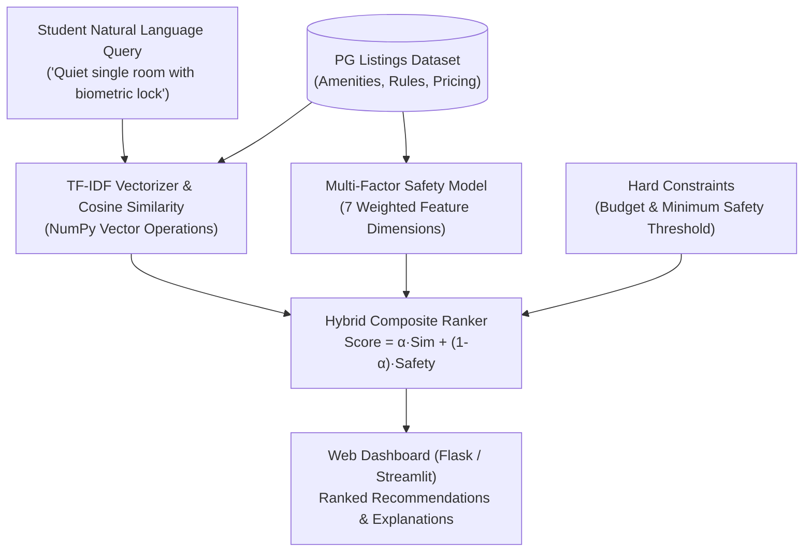

# 🛡️ SafeNest AI: Intelligent Safe Accommodation Discovery Platform

[](https://www.python.org/downloads/)
[](https://opensource.org/licenses/MIT)
[]()

> An AI-driven accommodation discovery engine designed to solve the safety and recommendation friction for university students, especially young women relocating to campus.

---

## 🌟 Overview & Problem Statement

Traditional PG and hostel finder applications rely on rigid, binary database filters (e.g. *Price < 8000 AND WiFi = Yes*). However, student housing decisions are deeply nuanced:
- Students describe preferences in natural language (e.g. *"quiet single room with strict night security and healthy meals"*).
- Safety cannot be reduced to a checkbox; it requires multi-factor evaluation of physical security, supervision, street lighting, and campus proximity.

**SafeNest AI** introduces two interconnected machine learning components:
1. **Semantic Preference Search**: A sublinear TF-IDF vectorizer and cosine similarity ranking engine that parses student natural language queries against accommodation corpora.
2. **Explainable Safety Index**: A multi-criteria weighted decision model providing a 0–100% normalized safety rating with individual factor attribution (CCTV, 24/7 security, resident warden, biometric access, and street lighting).

---

## 📐 System Architecture



---

## 🔬 Mathematical Methodology

### 1. Vector Space & Term Weighting
Document representations use sublinear term frequency scaling and smooth inverse document frequency:

$$\text{TF}_{\text{sublinear}}(t, d) = \begin{cases} 1 + \ln(\text{tf}(t, d)) & \text{if } \text{tf}(t, d) > 0 \\ 0 & \text{otherwise} \end{cases}$$

$$\text{IDF}(t, D) = \ln\left(\frac{N + 1}{\text{DF}(t) + 1}\right) + 1$$

Similarity is calculated via cosine angle between normalized query vector $\vec{q}$ and accommodation vector $\vec{d}$:

$$\text{Sim}(\vec{q}, \vec{d}) = \frac{\vec{q} \cdot \vec{d}}{\|\vec{q}\|_2 \|\vec{d}\|_2}$$

### 2. Multi-Criteria Safety Scoring
The Safety Index is calibrated across 7 weighted security features:

$$\text{Safety Index} = \sum_{i=1}^{7} w_i \cdot f_i \quad \text{where } \sum w_i = 1.0$$

- **24/7 Security Guard**: 25%
- **CCTV Coverage**: 20%
- **Biometric / Smart Lock**: 15%
- **Resident Warden**: 15%
- **Street Lighting Quality**: 10%
- **Emergency SOS Alarms**: 10%
- **Campus Proximity Decay**: 5%

---

## 🚀 Quick Start

### 1. Clone & Setup
```bash
git clone https://github.com/YOUR_USERNAME/safenest-ai.git
cd safenest-ai
pip install -r requirements.txt
```

### 2. Run the Web Dashboard
```bash
python app.py
```
Open **[http://127.0.0.1:5000](http://127.0.0.1:5000)** in your browser.

*(Optional)* Or launch the Streamlit dashboard edition:
```bash
streamlit run app_streamlit.py
```

---

## 💡 Future Roadmap (AI/ML Domain)
- [ ] Transition from TF-IDF to transformer embeddings (`sentence-transformers/all-MiniLM-L6-v2`) via Hugging Face.
- [ ] Incorporate sentiment analysis on student reviews to detect fake/paid reviews.
- [ ] Computer vision pipeline to auto-verify PG room photos against duplicate web images.

---

## 👤 Author
**AI/ML Lead Candidate (2026–27)**  
Developed as an engineering prototype for campus student living safety.
